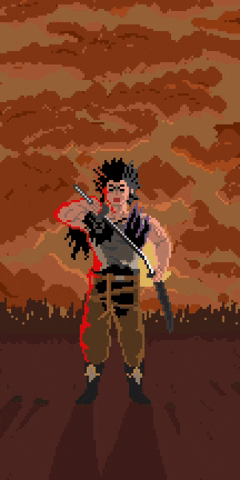

<table>
  <tr>
    <td width="70%" valign="top">
      <h1>Hi  My name is Wortwurzel</h1>
      <h3>Im a Coder &amp; Designer</h3>
      <ul>
        <li>🌍 I'm based in Hage Village</li>
      </ul>
      

        
      

      <h3>Socials</h3>
      

        <a href="https://www.github.com/wortwurzel" target="_blank" rel="noreferrer"> <picture> <source media="(prefers-color-scheme: dark)" srcset="https://raw.githubusercontent.com/danielcranney/readme-generator/main/public/icons/socials/github-dark.svg" /> <source media="(prefers-color-scheme: light)" srcset="https://raw.githubusercontent.com/danielcranney/readme-generator/main/public/icons/socials/github.svg" />  </picture> </a>
      

    </td>
    <td width="30%" align="center" valign="top">
      
    </td>
  </tr>
</table>
